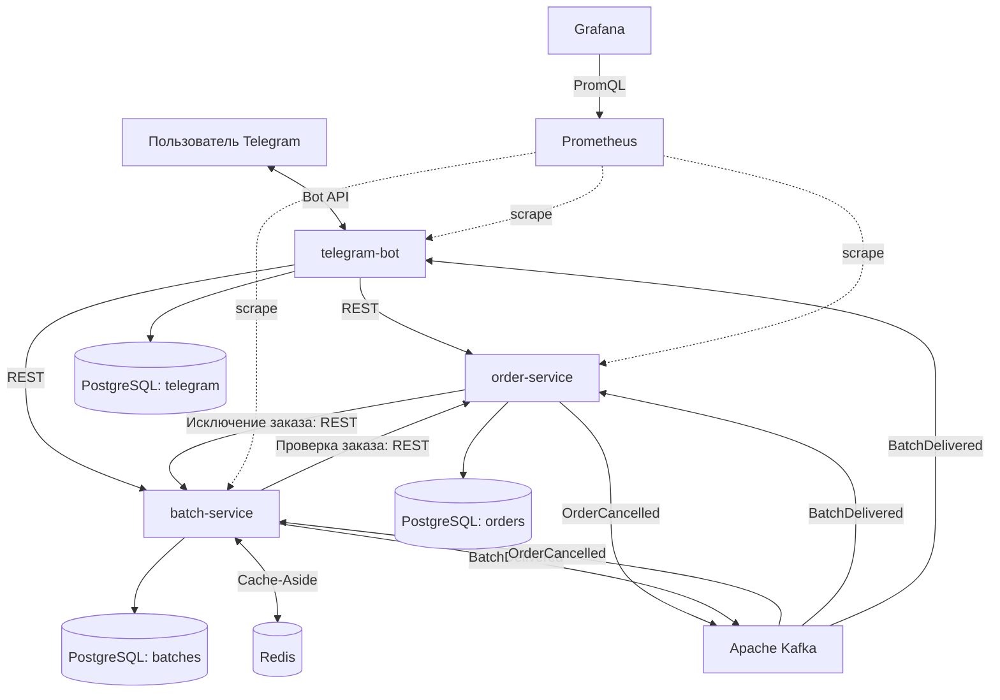
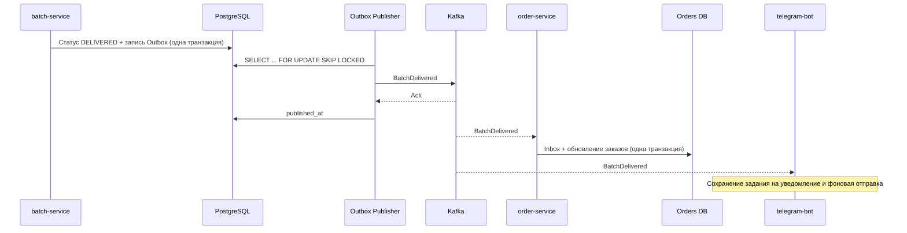

# NeighborRoute

**Java Backend · Event-Driven Microservices · Distributed Data Consistency**


NeighborRoute — микросервисная система коллективной доставки товаров для жителей многоквартирных домов. Заказы из одного магазина на один адрес автоматически объединяются в группу доставки с ограниченным временем сбора. Пользователь взаимодействует с системой через Telegram-бота.

Проект посвящён не только реализации REST API, но и решению задач распределённых систем: согласованности данных между сервисами, надёжной публикации событий, конкурентных транзакций, идемпотентности и восстановления после сбоев.

## Ключевые инженерные решения

| Задача | Реализация |
| --- | --- |
| Атомарность изменения данных и создания событий | Transactional Outbox, PostgreSQL, Kafka |
| Повторная доставка сообщений | Transactional Inbox, уникальные идентификаторы событий |
| Ошибки обработки Kafka-событий | Retry, Dead Letter Topic, утилита `DltReplayCli` |
| Согласованность отмены заказа между сервисами | Координатор операции, промежуточный статус `CANCEL_PENDING`, фоновое восстановление |
| Конкурентное создание групп доставки | PostgreSQL Advisory Locks, повторная проверка состояния заказа |
| Защита от потерянных обновлений | Optimistic Locking (`@Version`), Pessimistic Locking |
| Параллельная обработка фоновых задач | `SELECT ... FOR UPDATE SKIP LOCKED` |
| Единственное активное участие заказа в группе | Частичный уникальный индекс PostgreSQL |
| Кэширование изменяемых данных | Redis, Cache-Aside, TTL, инвалидация после коммита, fallback к PostgreSQL |
| Наблюдаемость | Spring Boot Actuator, Micrometer, Prometheus, Grafana, бизнес-метрики |
| Проверка интеграций | JUnit 5, Mockito, Testcontainers с PostgreSQL, Kafka и Redis |

## Архитектура



Система состоит из трёх независимо развёртываемых Spring Boot приложений. Каждый сервис владеет собственной PostgreSQL-базой (**Database per Service**). Синхронные операции выполняются через REST, доменные события распространяются через Kafka. Между базами нет внешних ключей и общей транзакции.

| Сервис | Порт | Ответственность |
| --- | --- | --- |
| [`order-service`](services/order-service/) | `8080` | Создание, подтверждение и отмена заказов, жизненный цикл заказа, Outbox/Inbox |
| [`batch-service`](services/batch-service/) | `8081` | Автоматическая группировка, конкурентное присоединение заказов, закрытие и доставка групп, Redis-кэш |
| [`telegram-bot`](services/telegram-bot/) | `8082` | Регистрация, состояние диалога, оформление заказов, история и уведомления |

## Как работает система

1. Пользователь запускает бота командой `/start`, указывает адрес и оформляет заказ.
2. `order-service` сохраняет заказ и его позиции, затем заказ подтверждается.
3. `batch-service` проверяет статус заказа, ищет открытую группу с совпадающими магазином и адресом или создаёт новую группу на 10 минут.
4. Пока группа открыта, пользователь может отменить собственный заказ. По истечении времени группа закрывается либо переходит в `EXPIRED`, если не содержит активных заказов.
5. После подтверждения доставки `batch-service` публикует событие `BatchDelivered` через Outbox. `order-service` обновляет статусы заказов, а `telegram-bot` формирует уведомления.

### 1. Надёжная событийная архитектура



- Outbox сохраняется в одной локальной транзакции с изменением бизнес-состояния. При недоступности брокера неопубликованная запись остаётся в БД для последующей попытки.
- Publisher использует блокировку строк `FOR UPDATE SKIP LOCKED`, подтверждение Kafka и отметку `published_at`.
- Inbox в `order-service` атомарно фиксирует идентификатор события и обновляет заказы. Повторное событие не приводит к повторному изменению бизнес-состояния.
- Для проблемных событий настроены повторные попытки, DLT и ручной повторный запуск обработки.

**Гарантии:** доставка событий рассчитана на at-least-once, а не на глобальный exactly-once. Если сервис завершится после подтверждения Kafka, но до коммита отметки Outbox, возможна повторная публикация; для этого используется дедупликация потребителей.

Основные события: `OrderCancelled` (`orders.events.v1`) и `BatchDelivered` (`batches.events.v1`). Событие отмены регистрируется в Inbox `batch-service`; само исключение заказа из группы выполняется синхронно через REST.

### 2. Согласованность распределённой отмены

Отмена заказа затрагивает две независимые БД. Локальная аннотация `@Transactional` не может откатить уже завершившуюся операцию другого сервиса.

`OrderCancellationCoordinator` выполняет операцию по шагам:

- Фиксирует промежуточное состояние `CANCEL_PENDING` для подтверждённого заказа.
- Запрашивает исключение заказа из группы через REST API.
- При успехе завершает отмену и сохраняет событие `OrderCancelled` в Outbox. При бизнес-конфликте восстанавливает допустимое состояние заказа.
- `OrderCancellationRecoveryScheduler` повторно обрабатывает незавершённые отмены после временных ошибок и перезапуска приложения.

Это механизм координации и восстановления распределённой операции без XA и двухфазного коммита.

### 3. Конкурентность и инварианты PostgreSQL

При одновременном оформлении заказов на один адрес необходимо исключить создание нескольких конкурирующих групп и повторное добавление одного заказа.

Используются транзакционные Advisory Locks по идентификатору заказа и ключу группировки `(store_id, delivery_building)`, повторная проверка актуального состояния, блокировки строк и ограничения БД.

```sql
CREATE UNIQUE INDEX uq_active_batch_order
    ON batch_orders (order_id)
    WHERE status = 'ACTIVE';
```

Индекс гарантирует, что один заказ не может одновременно состоять в двух активных группах. Для конкурентных изменений заказа используется `@Version`, а в отдельных сценариях — пессимистические блокировки.

### 4. Redis и согласованность кэша

Открытые группы доставки кэшируются по магазину и адресу (Cache-Aside, TTL 180 секунд). Изменение состава группы, её закрытие или доставка регистрируют инвалидацию кэша после успешного коммита транзакции. При недоступности Redis чтение может выполняться из PostgreSQL. Кэш не является источником истины; корректность записи обеспечивается БД.

### 5. Уведомления Telegram

Событие доставки формирует сохраняемое в PostgreSQL задание на отправку уведомления. Повторные Kafka-события дедуплицируются, а конкурентные обработчики выбирают задачи с помощью `SKIP LOCKED`.

При неопределённом результате внешнего вызова Telegram API или зависшей отправке задание переводится в `REVIEW_REQUIRED`: автоматическая повторная отправка в такой ситуации может привести к дублированию сообщения. Гарантия exactly-once для внешнего Telegram API не заявляется.

## Технологический стек

| Область | Технологии |
| --- | --- |
| Backend | Java 21, Spring Boot, Spring MVC, Spring Data JPA, Hibernate, Spring JDBC, Spring RestClient |
| Хранение данных | PostgreSQL 17, Flyway, Redis 7, Spring Cache |
| Messaging | Apache Kafka 4.1.2 (KRaft), Spring Kafka |
| Клиент | Telegram Bot API, Long Polling |
| Тестирование | JUnit 5, Mockito, Testcontainers |
| Инфраструктура | Docker, Docker Compose, Maven, Eclipse Temurin (Java 25 в Docker-образах) |
| Мониторинг | Actuator, Micrometer, Prometheus, Grafana |

## REST API

Все маршруты ниже относятся к уже реализованным интерфейсам.

| Метод | Endpoint | Назначение |
| --- | --- | --- |
| POST | `/api/v1/orders` | Создание заказа |
| GET | `/api/v1/orders/{id}` | Получение заказа |
| POST | `/api/v1/orders/{id}/confirm` | Подтверждение |
| POST | `/api/v1/orders/{id}/cancel` | Отмена |
| POST | `/api/v1/batches/join` | Автоматическое присоединение к группе |
| DELETE | `/api/v1/batches/orders/{orderId}` | Исключение заказа из группы |
| GET | `/api/v1/batches/open` | Поиск открытых групп по магазину и адресу |
| GET | `/api/v1/batches/{batchId}` | Получение группы |
| POST | `/api/v1/batches/{batchId}/close` | Закрытие группы |
| POST | `/api/v1/batches/{batchId}/deliver` | Подтверждение доставки |

## Тестирование

В проекте реализованы модульные и интеграционные тесты, в том числе с реальными PostgreSQL, Kafka и Redis в Testcontainers. Проверяются:

- Откат транзакции при ошибке создания заказа и конкурентные изменения состояний.
- Одновременное присоединение заказов к группам и соблюдение бизнес-инвариантов.
- Публикация Outbox, обработка Kafka-событий и повторная доставка.
- Кэширование, инвалидация и работа при недоступности Redis.
- Координация отмены, восстановление незавершённых операций и обработка уведомлений.

Запуск из корня проекта (нужен работающий Docker):

```bash
mvn -f services/order-service/pom.xml clean verify
mvn -f services/batch-service/pom.xml clean verify
mvn -f services/telegram-bot/pom.xml clean verify
```

Также выполнен ручной сквозной сценарий с Telegram, объединением заказов, доставкой, отменой, Kafka и перезапуском контейнеров.

## Мониторинг

Prometheus собирает метрики приложений через `/actuator/prometheus`. Grafana визуализирует доступность сервисов, HTTP throughput и latency (p95), ошибки, JVM, CPU, HikariCP и Kafka Consumer Lag.

Дополнительно реализованы собственные бизнес-метрики Micrometer:

| Метрика | Назначение |
| --- | --- |
| `neighborroute_orders` | Количество заказов по статусам |
| `neighborroute_batches` | Количество групп по статусам |
| `neighborroute_outbox_pending` | Неопубликованные Outbox-события |
| `neighborroute_users` | Зарегистрированные пользователи |
| `neighborroute_notifications` | Уведомления по статусам |

## Локальный запуск

Требования: Docker с Compose v2, токен Telegram-бота, доступ к Telegram API. Для запуска тестов вне Docker — JDK 21 или совместимый JDK и Maven.

Из корня проекта собрать образы:

```bash
docker build -t neighborroute/order-service:local ./services/order-service
docker build -t neighborroute/batch-service:local ./services/batch-service
docker build -t neighborroute/telegram-bot:local ./services/telegram-bot
```

В каталоге с `compose.yaml` создать локальный `.env`:

```dotenv
TELEGRAM_BOT_TOKEN=<your_bot_token>
TELEGRAM_DB_PASSWORD=<your_local_database_password>
```

Не добавляйте `.env` и реальные секреты в Git.

**Настройка окружения:** если в Compose используются существующие `external` volumes, для чистого развёртывания необходимо создать соответствующие тома либо заменить их определения на обычные именованные volumes. Не удаляйте тома действующего окружения. При необходимости скорректируйте или уберите локальные настройки SOCKS-прокси Telegram-бота; без прокси контейнеру нужен прямой доступ к Telegram API. Конфигурация адресов между сервисами должна использовать DNS-имена Docker Compose, а не `localhost`.

```bash
docker compose up -d
docker compose ps
```

При наличии конфигураций мониторинга в Compose доступны:

| Компонент | Адрес |
| --- | --- |
| Order Service | http://localhost:8080/actuator/health |
| Batch Service | http://localhost:8081/actuator/health |
| Telegram Bot | http://localhost:8082/actuator/health |
| Prometheus | http://localhost:9090/targets |
| Grafana | http://localhost:3000 |

Для демонстрации отправить боту `/start` и оформить заказ. Тестовые операции закрытия и доставки группы выполняются через REST API.

## Текущее состояние и дальнейшее развитие

Рабочий MVP: автоматическое объединение заказов, отмена, обработка доставки, уведомления, сохранение состояния, контейнерное развёртывание и мониторинг. Backend поддерживает несколько позиций заказа, текущий Telegram-сценарий — одну позицию и фиксированный магазин.

Следующие расширения: каталог магазинов и товаров, многопозиционная корзина в Telegram, просмотр групп дома в боте, распределение стоимости доставки, уведомление о закрытии группы, защита REST API и автоматизированные сквозные тесты.

Проект предназначен для локальной демонстрации; публичное развёртывание требует дополнительной настройки аутентификации, авторизации и инфраструктурной безопасности.
